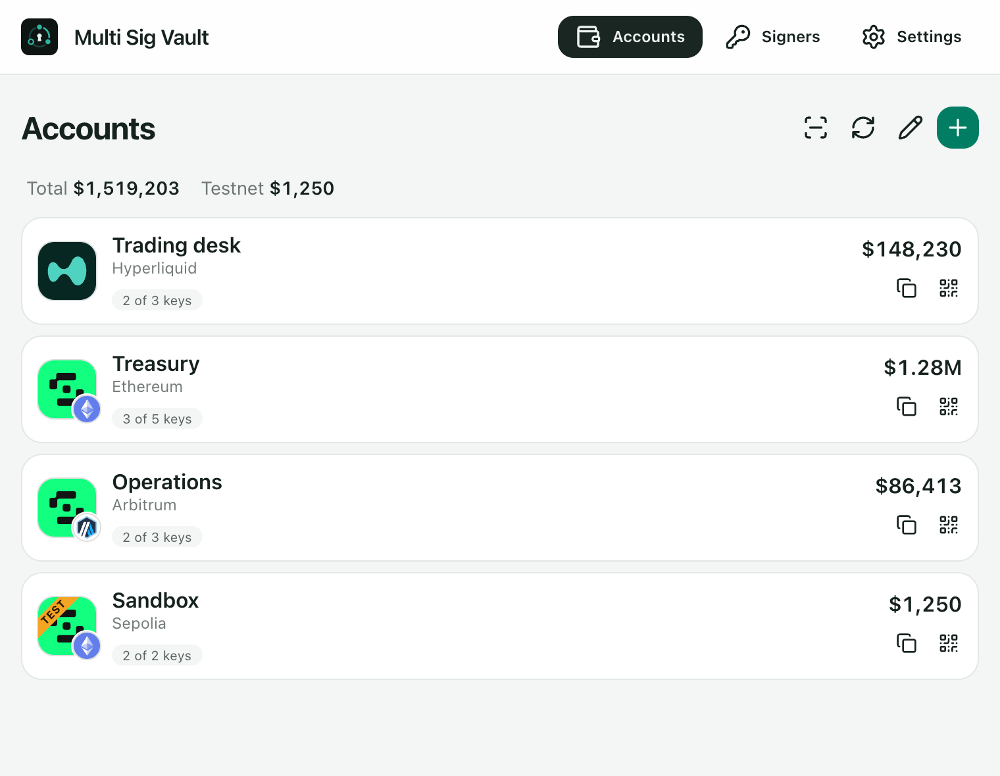

# Multi Sig Vault

**[multi-sig.quoi.dev](https://multi-sig.quoi.dev)**



A PWA for operating Hyperliquid multi-sig accounts and Safe wallets on Ethereum, HyperEVM, Arbitrum, Base and Polygon (mainnet and testnet).

It is built for signers who are never in the same place. You sign with the first key, carry the operation to the second device as a QR code, sign there, and broadcast from wherever you end up. Keys stay on MetaMask, Trezor and Ledger; the network is needed only to read balances and to send.

The code was written with AI, directed and reviewed by a developer with many years of hands-on programming experience.

## Don't trust, verify

This app builds the payloads your wallets sign, so a backdoor in it could drain every account it touches. Do not take the author's word that there is none: before using it, point your own AI agent at this repository and have it audit the code and dependencies for swapped recipients, altered payloads, key exfiltration and unexpected network calls. Then build from the commit you reviewed instead of using a copy somebody else hosts.

## What goes through a server, and what is signed

Almost nothing leaves your device except requests to public APIs: chain RPC endpoints, Hyperliquid, Unit, Circle and the Safe Transaction Service. Two things are worth knowing before you rely on the hosted copy.

**MetaMask on a phone goes through our relay.** On Android and iOS, a request for MetaMask (a signature, a transaction, the list of accounts) and its answer pass through a small server of ours on the way between the app and MetaMask's built-in browser. Desktop MetaMask, Trezor and Ledger never use it. What protects you there:

- The request and the answer are encrypted on your device with AES-256-GCM. The key is shared between your app and your MetaMask browser on first use, by a six-digit code you type yourself, and never reaches the server.
- The relay stores ciphertext under a random one-time id, in memory only, for ten minutes at most. It cannot read a message, and it cannot alter one unnoticed: a changed message fails authentication.
- A link sent by somebody else cannot make the signing page ask for a signature, because it cannot be decrypted with your key.
- Every signature is checked against the signer's address after it comes back.
- What the server side does see is metadata: your IP address, the time and the random id of the exchange. The relay itself writes no logs, but the web server in front of it and Cloudflare keep ordinary access logs with exactly that metadata.

Details are in [MetaMask on a phone](#metamask-on-a-phone). The relay is `relay/server.mjs`, one file with no dependencies; a copy of the app hosted without it falls back to MetaMask SDK.

**Icons of exchange coins come through the same relay, without telling it what you hold.** Hyperliquid serves its coin icons in a way a browser app cannot fetch, so the relay re-serves them from a disk cache (30 days by default, `ICON_CACHE_DAYS`). The app never asks for the icon of a coin on your account. Once a week it downloads the icons of every listed coin that is not already built in, in the exchange's own listing order, so every user sends the relay the same requests and it cannot tell which coins anybody holds. The icons the app starts with are part of the build; turning off "Update weekly" for token lists stops these downloads too. Token logos on EVM networks follow the same rule: whole lists, never per holding.

**Stable updates are signed on-chain.** The installed app offers an update only after the developer's Safe [`0x22222222e8d995EA51841abc49022Fb5eb7C62b4`](https://hyperevmscan.io/address/0x22222222e8d995EA51841abc49022Fb5eb7C62b4) (2 of 3 signers) has approved that exact release: its id commits to the SHA-256 of every file. The Safe signs on HyperEVM; the app looks there and on Ethereum, asks two independent RPC endpoints on each, and accepts an approval on either. Unsigned test builds are installed only if you turn on "Test versions" in settings. The check protects installed copies; a first visit, and the service worker file itself, are served as the site has them. Details are in [Offline use and updates](#offline-use-and-updates).

## What it does

**Accounts**

- Hyperliquid accounts, plain and multi-sig, in standard, unified and portfolio margin modes.
- Safe 1.3.0, 1.4.1 and 1.5.0.
- Balances per asset, refreshed every 30 seconds and kept for offline viewing. An exchange account also shows how much can be withdrawn when orders or margin hold part of it. With open positions it shows their unrealized PnL together, and for each position its entry and mark price and the funding since it was opened.
- One total for mainnet and a separate one for testnet, over the accounts you have not hidden.
- History on its own page, newest first, with the signers of each operation.

**Signers**

- MetaMask (browser extension, or the MetaMask app on a phone), Trezor, Ledger.
- Hardware wallets use the same derivation paths as Trezor Suite and Ledger Live.

**Hyperliquid operations**

- Send and withdraw USDC, send spot tokens, move funds between spot and perps.
- Withdraw spot assets to their native chain through Unit (BTC, ETH, SOL and others) or to HyperEVM.
- Approve and revoke agent keys, and log in to the exchange web UI by link or QR, for 1 to 180 days.
- Create and manage sub-accounts.
- Convert an account to multi-sig, change its signers, convert it back.

**Safe operations**

- Send native coins and tokens.
- Swap on Uniswap V3 (HyperSwap V3 on HyperEVM), quoted directly from the pools.
- Bridge USDC between any two supported networks through Circle CCTP V2, alone or right after a swap.
- Change owners and threshold.
- Call a contract by ABI, deploy a contract, sign a message hash (EIP-1271).
- Choose a slower or a faster network fee; a transaction that stays unconfirmed can be sent again with the same signatures.
- Any of your signers can send a signed transaction and pay its fee. A Safe can be limited (account settings, kept on the device) to its own signers or to the signers you choose.

**Creating a Safe**

- At a new address, at the address of your Safe on another network, or at a vanity address mined with `deadbeef`.

**Working across devices**

- An operation travels as a QR code, animated when it does not fit in one frame. QR is the only export channel, because an operation may carry an agent private key.
- One scanner on the home screen accepts addresses and operations. Imports are deduplicated and their signatures merged.
- Several windows of the app can be open at once: a change made in one shows in the others, and a window that was asleep catches up when you return to it.
- Installs as a PWA and works offline; an update is installed only after you agree, and by default only when the developer's Safe has signed it.
- A link can open the add-account or create-Safe form already filled in.

## Supported networks

| Network | Chain id | Swap | USDC bridge | Safe history |
|---|---|---|---|---|
| Ethereum | 1 | Uniswap V3 | yes | yes |
| HyperEVM | 999 | HyperSwap V3 | yes | yes |
| Arbitrum | 42161 | Uniswap V3 | yes | yes |
| Base | 8453 | Uniswap V3 | yes | yes |
| Polygon | 137 | Uniswap V3 | yes | yes |
| Sepolia | 11155111 | Uniswap V3 | yes | yes |
| HyperEVM Testnet | 998 | HyperSwap V3 | yes | no |
| Arbitrum Sepolia | 421614 | Uniswap V3 | yes | no |
| Base Sepolia | 84532 | Uniswap V3 | yes | yes |
| Polygon Amoy | 80002 | no | yes | no |

Safes work on all ten. The Hyperliquid exchange is supported on its mainnet and testnet. Safe history needs the Safe Transaction Service, which does not cover every testnet; Uniswap is not deployed on Polygon Amoy.

## Deep links

A link can open the form for adding an account or creating a Safe already filled in:

```
https://multi-sig.quoi.dev/#/link?action=add&kind=hl&env=testnet&address=0x…&name=Desk
https://multi-sig.quoi.dev/#/link?action=add&kind=safe&chain=base&address=0x…
https://multi-sig.quoi.dev/#/link?action=create&chain=arbitrum&owners=0x…,0x…&threshold=2&name=Treasury
https://multi-sig.quoi.dev/#/link?action=create&chain=base&mode=vanity&owners=0x…,0x…&threshold=2&prefix=0xdead
```

| Parameter | Used by | Values |
|---|---|---|
| `action` | both | `add` (existing account) or `create` (new Safe) |
| `kind` | `add` | `hl` or `safe` |
| `chain` | Safe | `ethereum`, `hyperevm`, `arbitrum`, `base`, `polygon` |
| `env` | both | `mainnet` (default) or `testnet` |
| `address`, `name` | `add` | account address and an optional name |
| `owners`, `threshold`, `name` | `create` | comma-separated owner addresses, signatures required, optional name |
| `mode` | `create` | `new` (default), `copy` (same address as a Safe on another chain) or `vanity` |
| `salt` | `create` | decimal salt nonce, to reproduce an exact address in `new` mode |
| `prefix` | `create` | hex address prefix for `vanity` mode |

A link only fills the form. The form says it came from a link, every field can be changed, and nothing is added or created until you confirm. Unknown parameters are ignored. Links can be turned off in settings.

## How signing is protected

1. The first signature freezes the operation. Quotes, nonces and fees are resolved, and the payload is built from them.
2. Building a payload is a pure, deterministic function. Before every signature, before broadcast and on import, the payload is rebuilt from the parameters shown on screen and compared with the stored one. A mismatch blocks the operation.
3. Every signature is checked by recovering its address. An imported operation with an invalid signature is rejected whole.
4. Safe transactions are simulated before signing and before sending (`SimulateTxAccessor`, `eth_estimateGas`).
5. Unit deposit addresses are accepted only with valid guardian signatures (2 of 3), verified in the app each time the operation is built.

The app stores no private keys, with one exception: a Hyperliquid agent key you ask it to generate. That key is kept in IndexedDB, encrypted with a non-extractable WebCrypto key, and is erased together with the result card.

Wherever the wallet supports it, operations are signed as structured EIP-712 data that the device can display. For Ledger, the "clear signing" setting (on by default) allows fetching field descriptors from Ledger's servers. The order of attempts is fields with descriptors, then fields without, then blind signing only when the device accepts nothing else.

The production build ships a strict CSP with no inline or third-party scripts. External data (token lists, API responses, QR contents) is validated, and remote SVGs are rendered only through ``.

## MetaMask on a phone

In Chrome on a phone the app cannot talk to the MetaMask app directly, and Android freezes the page while MetaMask is in front, so answers sent to it get lost. Instead the request is handed to the app's own signing page inside MetaMask's built-in browser, where the wallet is part of the page:

1. The app encrypts the request (AES-256-GCM) and leaves it on a small relay (`relay/server.mjs`).
2. You tap "Open MetaMask". The signing page opens in MetaMask's browser, decrypts the request, shows it and asks MetaMask.
3. The encrypted answer goes back through the relay, and the app picks it up when you return.

The key belongs to the connection between your app and your MetaMask browser. On first use the app shows a six-digit code that you type into the signing page; from then on both sides hold a shared key, and each request is encrypted with a key derived from it for that one request. The signing page shows only what it can decrypt with that key, so a link somebody sends you cannot ask you to sign anything: it ends in an error.

The relay is a blind mailbox. It sees ciphertext only, cannot read or change a request or an answer without failing authentication, keeps a session in memory for ten minutes and writes no logs of its own (the proxy in front of the hosted one keeps access logs: IP address, time, the random session id). The worst it can do is lose a message. Every signature is still verified against the signer's address. The desktop extension and MetaMask's own browser need no relay; a copy of the app hosted without one falls back to MetaMask SDK.

## Offline use and updates

The service worker (`public/sw.js`) is the same file in every release and serves only the files of the active release. A new version is downloaded by the running app, each file is checked against its SHA-256, and it is activated only after you agree.

Every published release stays on the server at `releases/<id>/`, and `releases.json` lists them newest first. That gives two update channels from one deployment:

- **Stable** (the default). The app installs the newest release the developer's Safe approved on-chain, and only moves to a higher version. The site root serves the same release, so a first-time visitor gets it too.
- **Test versions** (a switch in settings). The app installs the newest release, signed or not.

Nothing changes on the server when a release gets signed: clients ask the chain which listed release is approved.

```bash
PUBLIC_RELEASE_SAFE=0x… PUBLIC_RELEASE_CHAIN_ID=999,1 pnpm build
pnpm release:info   # release id, digest and the transaction for the developer's Safe
```

The developer's Safe executes `SignMessageLib.signMessage(digest)`; in the app this is the "Sign message hash" operation. Clients call `isValidSignature(digest, "")` (EIP-1271) on two independent RPC endpoints of each network listed in `PUBLIC_RELEASE_CHAIN_ID`, and an approval on any one of them is enough. This is sound because a Safe's address commits to the signers it was created with: at the same address on another network there can only be a Safe that started with those signers. One consequence to keep in mind: a signer removed later still counts on a network where the Safe has not been created yet, so after changing signers, create the Safe on every listed network and change them there too. A build without these variables has no stable channel and follows the newest release. `scripts/release/publish.sh` is the deployment: it uploads the build, extends the list and puts the newest approved release at the root.

## Tech stack

- TypeScript, React 19, React Router (hash routing)
- Rsbuild, Tailwind CSS 4, DaisyUI 5
- zustand, persisted to IndexedDB and synced between tabs over BroadcastChannel
- viem for EVM, `@msgpack/msgpack` and `@noble/curves` for Hyperliquid and Unit
- `@metamask/sdk`, `@trezor/connect-web`, `@ledgerhq/hw-app-eth` over WebHID and WebUSB
- vitest, Biome, pnpm

There is no application backend. The app talks directly to chain RPC endpoints and to the Hyperliquid, Unit, Circle and Safe Transaction Service APIs; the only server of its own is the blind relay for MetaMask on a phone.

## Running

```bash
pnpm install
pnpm dev       # http://localhost:5173
pnpm build     # production build in dist/, with release.json
pnpm preview
pnpm test      # unit tests, offline
pnpm format    # Biome: tabs, double quotes
```

Fork tests need `anvil` and network access:

```bash
MSV_FORK=1 pnpm vitest run tests/*.fork.test.ts
```

## Limitations

- **Hyperliquid L1 actions** (creating and renaming a sub-account) are signed in a domain with chainId 1337, which MetaMask refuses. They need a Ledger or Trezor, and they are signed as a hash.
- **Spot withdrawal to HyperEVM** always arrives at the same address. For a multi-sig account, that address on HyperEVM is controlled by the original key. The app warns about this.
- **Hyperliquid history** of actions that move no funds (agent approvals, multi-sig changes) comes from the explorer, which returns only an account's latest 300 transactions, trading included. On an account where an agent trades, older actions of this kind are listed only if they were sent from this app on this device; the page says from which date the exchange's answer starts. Money movements are complete.
- **Unit minimum amounts** are taken from the Unit documentation, not from an API.
- **Trezor** opens a Trezor Connect window, which needs either network access or a running Trezor Suite. **Ledger** connects directly and works offline.
- **MetaMask on a phone** signs in MetaMask's built-in browser, reached through the relay described above, and needs network access. To work fully offline, open the whole app in MetaMask's browser and move operations by QR.
- **MEV protection** (Flashbots Protect) applies to Ethereum transactions signed with Ledger or Trezor. MetaMask broadcasts its own transactions.
- **USDC bridge**: by default Circle's Forwarding Service delivers the funds, and the fee is taken exactly from Circle's API. If delivery does not happen, the result card lets any signer pay the gas for it.
- The first install, and any change to `sw.js` itself, cannot be covered by the on-chain release check. This is a limitation of the web platform.

## Project layout

```
src/config        chains and contract addresses
src/lib/hl        Hyperliquid: API, account data, signing, Unit
src/lib/safe      Safe: transactions, simulation, creation
src/lib/evm       DEX quotes, CCTP, ABIs
src/lib/ops       operations: registry, engine (freeze, verify, send), transfer
src/lib/wallets   MetaMask, Trezor and Ledger adapters
src/lib/qr        QR: addresses, packing, frames
src/lib/tokens    token lists and icons
src/lib/update    offline releases and signature check
src/lib/history   account history: Hyperliquid ledger and explorer, Safe Transaction Service
src/lib/handoff   encrypted hand-off to MetaMask's browser
relay             the relay server: blind mailbox for the hand-off, cached exchange icons
src/components    one component per file
src/i18n          en and ru
scripts           icons, token lists, dictionaries, release.json
```

To add a chain, add an entry to `src/config/chains.ts` and an icon. To add an operation, add a definition file and a line in `src/lib/ops/registry.ts`.

## License

[MIT](LICENSE)
